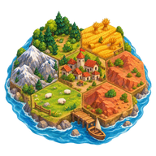

<p align="center">
  
</p>

<h1 align="center">Хексленд</h1>

<p align="center">
  Браузерная настольная игра про ресурсы, торговлю и стройку на острове из шестиугольников.<br>
  Общая карта на телевизоре, игроки ходят со своих телефонов.
</p>

<p align="center">
  <a href="https://hexland-540c6.web.app/host.html"><b>▶ Играть</b></a> ·
  <a href="КАК-ЗАПУСТИТЬ.md">Как запустить</a>
</p>

---

## Как это выглядит

1. Ведущий открывает [hexland-540c6.web.app/host.html](https://hexland-540c6.web.app/host.html) на ноутбуке у телевизора. На экране появятся PIN и QR-код.
2. Игроки сканируют QR телефоном, вводят имя и выбирают цвет.
3. На телевизоре видны карта, кубики, журнал событий и очки игроков. На телефоне у каждого свои карты, кнопки стройки и обмена.

Телевизора нет? Открой страницу ведущего прямо на телефоне и нажми «Играть с этого устройства». Так можно сыграть и в одиночку против ботов.

## Что умеет

- **От 3 до 6 участников.** Каждую партию карта новая. При 5–6 участниках поле больше: 30 гексов.
- **Вход как в Kahoot:** по PIN или QR, без регистрации. Можно играть из разных городов.
- **Обмен между игроками** со встречными предложениями, торговля с банком и через гавани.
- **Боты трёх уровней.** Лёгкий ходит почти наугад, средний играет с умом, сложный играет на победу. Боты честные: видят только то, что видел бы игрок.
- **Переподключение.** Если обновил страницу или пропала связь, возвращаешься на своё место с теми же картами.
- **Выход с ботом вместо себя.** Можно уйти посреди партии и вернуться. Если игрок отвалился и не вернулся вовремя, вместо него сам включится бот.
- **Настройки партии:** 8, 10 или 12 очков для победы и время ожидания отвалившихся игроков.
- Свой арт, звуки и анимации. Интерфейс на русском языке.

## Как устроено

| | |
|---|---|
| Интерфейс | React 19 + TypeScript, сборка Vite |
| Сеть | Firebase Realtime Database + анонимный вход + Hosting. Своего сервера нет |
| Правила | чистый движок в `src/engine/`, без сети и интерфейса, покрыт тестами (Vitest) |

**Главный — ведущий.** Игроки только отправляют действия, а страница ведущего проверяет их движком и записывает новое состояние в базу. Каждый игрок получает общую картину и свои карты. Чужие карты на телефон не приходят.

```
src/
  engine/   правила: карта, ход, обмен, разбойник, карты развития, победа
  bots/     боты трёх уровней
  net/      комнаты Firebase, вход, переподключение
  host/     экран ведущего (host.html)
  play/     экран игрока (index.html)
  board/    отрисовка карты
test/       тесты движка и ботов; test/live — тесты с настоящей базой
```

## Запустить у себя

Нужен Node.js 22 или новее.

```bash
npm install
npm run dev     # открыть <адрес>/host.html
npm test        # тесты движка и ботов
```

Подробнее в [КАК-ЗАПУСТИТЬ.md](КАК-ЗАПУСТИТЬ.md): там игра с телефонов в локальной сети, выкладка и подключение своего проекта Firebase.

---

Игровая механика в духе классических настольных игр о поселенцах. Название, арт, оформление и тексты правил свои.
